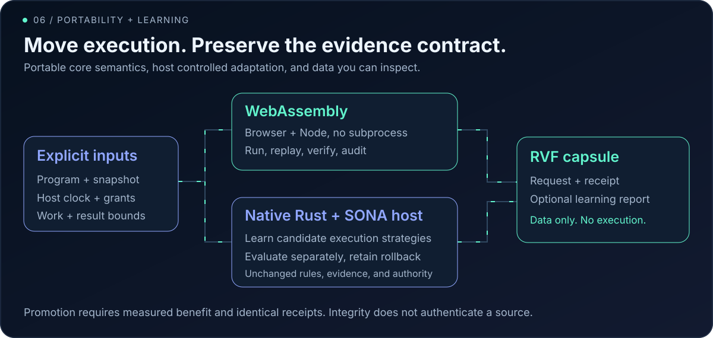

# RuGraph

**[Open the interactive WASM Explorer →](https://ruvnet.github.io/ruGraph/)** · [Explorer guide](explorer/README.md)

**A graph programming language for AI systems that need traceable decisions. Built on RuVector.**

RuGraph turns graph relationships, vector similarity, and signed observations into bounded, inspectable programs. Follow dependencies, apply explicit evidence rules, report contradictions, and trace a conclusion back to its selected observations and sources. Learned predictions have a separate type, so a model score cannot silently become evidence.

Write a `.rvg` program or strict JSON. Execute through Rust, the CLI, JavaScript, TypeScript, Python, or WebAssembly. Every successful run returns a receipt with its output, input hashes, logical time, and work charged.

[Quick start](#quick-start) · [Walkthrough](#walkthrough-a-service-incident) · [How it works](#how-execution-works) · [Replay](#replay-a-decision) · [Evidence audits](#ask-what-changes) · [SDKs](#use-your-language) · [WASM, learning and RVF](#portable-execution-and-learning) · [Specification](docs/research/graph-language/SPEC.md)

| If your system needs to… | RuGraph provides |
|---|---|
| Explain an agent memory decision | Explicit observations, sources, expiry, and selected rule lineage |
| Investigate service dependencies | Bounded outgoing traversal and evidence rules |
| Rank related entities or hypotheses | Exact cosine similarity and optional native KGE scoring |
| Preserve disagreement | Separate positive and negative support with four evidence states |
| Check sensitivity or reproduce a result | Independent removal audits and receipt replay |

Version **0.1.0**, wire schema **1**. The implemented scope is immutable snapshots, eight operations, and bounded rules over the same subject. These are building blocks for applications; application accuracy depends on their data and rules.

## Quick start

Build the core runtime with Rust 1.90.0. It runs the included graph and evidence example without a model or external AI service.

```sh
git clone https://github.com/ruvnet/ruGraph.git
cd ruGraph
cargo +1.90.0 build --locked --manifest-path crates/ruvector-language/Cargo.toml
export RVG_CORE="$PWD/crates/ruvector-language/target/debug/rvg-core"

"$RVG_CORE" check crates/ruvector-language/examples/incident.rvg
"$RVG_CORE" run crates/ruvector-language/examples/incident.rvg \
  --snapshot crates/ruvector-language/examples/snapshot.json \
  --context crates/ruvector-language/examples/context.json > receipt.json
```

`receipt.json` contains the result and its evidence trail. The walkthrough commands below use Python 3 to inspect JSON and assemble a replay request. Keep the exported `RVG_CORE` path in the same shell.

## Walkthrough: a service incident

The API depends on a database and a cache. Telemetry explicitly reports that the database is failing and that the cache is not failing. One rule says that a failing subject is degraded.



This is the program you just ran:

```text
program diagnose {
  effect graph.read;
  effect decision.emit;
  budget 100000;
  let service = select ["api"];
  let dependencies = traverse service "DEPENDS_ON" depth 2;
  let errors = observe dependencies "Failing" within 300;
  let impacts = infer [errors] using ["failure_implies_degraded"];
  let decisions = assess impacts;
  emit decisions;
}
```

1. **Retrieve.** Select `api` and follow outgoing `DEPENDS_ON` edges for at most two hops. Traversal retains its seed nodes.
2. **Reason.** Read recent signed `Failing` observations. Apply the named rule to each subject with positive support. Rules can chain to a fixed point.
3. **Inspect.** Emit assessments for the evidence domain. Derived claims include the selected observation, source, and rule identifiers.

At the fixture's logical time of `1000`, the receipt contains:

| Subject | `Failing` | `Degraded` | What supports the result |
|---|---|---|---|
| `database` | `supported` | `supported` | `db-error-1` from `telemetry-a`; the rule derives `Degraded` |
| `cache` | `refuted` | `unknown` | `cache-healthy-1` explicitly refutes `Failing`; no rule refutes `Degraded` |
| `api` | `unknown` | `unknown` | No matching observation or applicable rule supports either claim |

Inspect those six assessments:

```sh
python3 - <<'PY'
import json
from pathlib import Path
receipt = json.loads(Path('receipt.json').read_text())
for item in receipt['output']['items']:
    print(item['subject'], item['predicate'], item['status'])
PY
```

The fixture's observations expire at time `1100`. Running with that clock produces `unknown` for all six assessments. The rule does not infer degradation of the API from degradation of its dependency; it applies to the same subject.

## Evidence that preserves uncertainty



A missing observation does not mean false. Conflicting observations remain visible. Expiry or deletion retracts conclusions on the next execution because each snapshot is evaluated afresh. Evidence states are categories, not probabilities or model confidence scores.

`predict` returns a typed prediction batch. Predictions cannot feed `infer` or `assess`; observations and explicit rules determine evidence decisions.

## How execution works



The host supplies the snapshot, clock, granted capabilities, work budget, and result limit. A program declares the capabilities it needs but cannot grant itself authority. Exceeding a bound fails the run without a partial successful receipt.

The Rust core performs no network, filesystem, shell, model download, or external provider operations. CLI and SDK hosts own file and process access. A trusted host can supply a predictor; the native adapter uses real RuVector graph and KGE implementations.

### Eight operations

| Operation | Example | Result |
|---|---|---|
| Find nodes | `nodes "Service"` | Nodes with the requested label |
| Select identities | `select ["api"]` | Explicit node set |
| Follow relationships | `traverse n "DEPENDS_ON" depth 2` | Reachable nodes, including seeds |
| Rank similarity | `similar n [0.1, 0.2] top 5` | Nodes ranked by exact cosine |
| Read observations | `observe n "Failing" within 300` | Signed observations and evidence domain |
| Apply rules | `infer [e] using ["failure_rule"]` | Signed Horn closure over the same subject |
| Score predictions | `predict n "Cause" model "incident_v1" top 3` | Separate typed prediction batch |
| Assess evidence | `assess e` | Four valued decisions and selected witnesses |

Full syntax, validation rules, and limits are in the [language specification](docs/research/graph-language/SPEC.md).

## Replay a decision



Build a request from the same program and fixture, then replay the saved receipt:

```sh
python3 - <<'PY'
import json
import os
import subprocess
from pathlib import Path
examples = Path('crates/ruvector-language/examples')
program = json.loads(subprocess.check_output(
    [os.environ['RVG_CORE'], 'compile', str(examples / 'incident.rvg')], text=True))
request = {
    'program': program,
    'snapshot': json.loads((examples / 'snapshot.json').read_text()),
    'context': json.loads((examples / 'context.json').read_text()),
}
Path('request.json').write_text(json.dumps(request))
PY
"$RVG_CORE" replay --request request.json --receipt receipt.json
```

`verify` checks a receipt's checksum. `replay` recomputes and requires the complete receipt to match. Neither authenticates a source or proves an observation true. Archive the inputs, model artifact if used, language version, toolchain, and target; replay needs compatible floating point behavior.

### CLI reference

```text
rvg-core check PROGRAM
rvg-core compile PROGRAM
rvg-core run PROGRAM --snapshot SNAPSHOT --context CONTEXT
rvg-core run --request REQUEST
rvg-core replay --request REQUEST --receipt RECEIPT
rvg-core verify RECEIPT
rvg-core audit --request REQUEST --audit-options OPTIONS
```

Programs accept text or strict program JSON. Requests contain `program`, `snapshot`, and `context`. Use `-` for one stdin input. Success writes JSON to stdout. Errors write structured JSON to stderr and exit with code `2`.

## Ask what changes

Remove one observation, source, or edge in a counterfactual trial, then inspect the changed decisions and selected witnesses. Every trial starts from the original snapshot.



Reuse the request from the replay walkthrough:

```sh
"$RVG_CORE" audit --request request.json \
  --audit-options crates/ruvector-language/examples/audit-options.json > audit.json
```

This fixture includes three independent removals: `db-error-1`, `telemetry-a`, and the `api-db` edge. Each removes the support retrieved for the database claims. Redundant evidence in other snapshots can preserve a conclusion even when its selected witness disappears.

Audits support 1 to 64 interventions with an explicit aggregate execution budget and no prediction steps. Reports distinguish a missing decision entry from an `unknown` assessment. They measure sensitivity to supplied inputs; they do not establish real world causality.

Both SDKs expose `client.audit(request, options)`. Explore the [agent memory application and benchmark](docs/research/graph-language/FRONTIER.md) or read the [audit ADR](docs/adr/ADR-GL-006-bounded-counterfactual-audits.md).

## Use your language

| Interface | Entry point | Guide |
|---|---|---|
| Rust | `ruvector_language::runtime::execute` | [Core library](crates/ruvector-language/README.md) |
| CLI | `rvg-core`, native `rvg`, and offline `rvg-model` | [Native runtime](crates/ruvector-language-native/README.md) |
| JavaScript / TypeScript | `RuGraph` from `@ruvector/graph-language` | [SDK and local installation](npm/packages/graph-language/README.md) |
| Python | `RuGraph` from `ruvector_language` | [SDK and local installation](python/ruvector-language/README.md) |
| WebAssembly | `loadRuGraph` from `@ruvector/graph-language-wasm` | [Browser and Node runtime](npm/packages/graph-language-wasm/README.md) |

The process SDKs invoke a trusted executable with bounded input, output, and timeouts. They do not automatically install a runtime or download a model. JavaScript rejects integers outside its safe range; Python supports full Rust `u64` timestamps. Existing crate names, package names, imports, and `RUVECTOR_LANGUAGE_BIN` remain stable. Install from this repository using the linked guides.

### Rust embedding

```rust,ignore
use ruvector_language::{parser, runtime, Context, Snapshot};

fn decide(source: &str, snapshot: &Snapshot, context: &Context)
    -> ruvector_language::Result<ruvector_language::Receipt>
{
    let program = parser::parse(source)?;
    runtime::execute(&program, snapshot, context, None)
}
```

### Native graph and model support

The native runtime captures real `GraphDB` data with `capture_quiescent` under a caller owned writer gate. `rvg` adds explicitly supplied model artifacts. `rvg-model` supports offline training, evaluation, and explicit promotion. Predictions use actual HolE or RotatE scorers and report model revision and hash. Model training and promotion happen outside program evaluation.

The core binary requires a supplied provider for prediction and does not load native model artifacts. See the [native runtime guide](crates/ruvector-language-native/README.md) for build commands, capture constraints, and model examples.

## Interactive browser tutorial

Save and reopen projects, inspect compiled programs, compare the last two executions, and restore their exact inputs. Mobile editing includes indentation, paired delimiters and an expandable source editor. Imported projects never execute automatically.

[Launch RuGraph Explorer](https://ruvnet.github.io/ruGraph/) to write and run real graph programs in your browser. The animated orbital graph view follows the RuVector Explorer style, with six guided lessons covering dependencies, conflicting evidence, expiry, permissions, cosine retrieval and counterfactual audits.

Change the database evidence or host clock, run the program, and select a node to inspect its sources and witnesses. Edit the program, snapshot or context; compare decisions, replay the complete receipt and export it as JSON. Every result comes from the same Rust runtime compiled to WASM, isolated in a terminable Worker. Inputs stay in browser memory. On phones, a portrait graph, large touch targets, lesson picker and persistent Run controls keep the tutorial usable. Pause motion at any time; system reduced motion preferences are respected.

```bash
bash scripts/build-explorer.sh
python3 -m http.server 8000 --directory explorer/dist
```

Open `http://localhost:8000`. Follow the [build and validation guide](explorer/README.md) for toolchain setup. The [deployment workflow](.github/workflows/explorer.yml) tests the tutorial and browser interactions before publishing updates from main.

## Portable execution and learning

[Validation evidence and reproduction steps](docs/research/graph-language/PORTABLE-VALIDATION.md).



### WebAssembly in browsers and Node

The WASM package executes the same Rust core locally, without a subprocess. It exposes `compile`, `check`, `run`, `replay`, `audit`, and `verify`. Requests and results are JSON strings so full `u64` timestamps survive the JavaScript boundary. Keep large integers as raw JSON rather than roundtripping them through JavaScript numbers.

```sh
rustup target add wasm32-unknown-unknown --toolchain 1.90.0
cargo +1.90.0 install wasm-bindgen-cli --version 0.2.105 --locked
bash scripts/test-graph-language-wasm.sh
```

After building, use the local Node module:

```js
import { readFile } from 'node:fs/promises';
import { loadRuGraph } from './npm/packages/graph-language-wasm/index.mjs';
const graph = await loadRuGraph();
const request = await readFile('request.json', 'utf8');
const receipt = graph.run(request);
console.log(graph.replay(request, receipt) === receipt); // true
```

[Browser loading and package installation](npm/packages/graph-language-wasm/README.md) use generated assets from the same build. The measured Node module is about **831 KiB** before compression. Inputs and outputs are capped at **16 MiB** each; the build caps linear memory at **256 MiB**, excluding JavaScript host memory. Use a Worker and host deadline for untrusted workloads. Native KGE providers and prepared snapshot handles are outside this WASM adapter.

### SONA proposals with a frozen evaluator

The optional native learning crate uses real RuVector **SONA trajectories, MicroLoRA adaptation, ReasoningBank retrieval, and Darwin Guard**. Learned pattern quality proposes ordinary or prepared execution. A separate evaluator checks distinct workloads, includes preparation and selector overhead, compares every receipt, and requires at least **10% latency reduction on every evaluation case**. Rejected candidates retain the ordinary strategy; the host can explicitly roll back an accepted recommendation.

```sh
bash scripts/test-graph-language-learning.sh
```

On the [recorded synthetic experiment](crates/ruvector-language-learning/reports/strategy-learning.json), the learned policy reduced batch latency **79.44%** relative to ordinary execution. Static prepared execution reduced it **79.46%**. This demonstrates working adaptation and gated selection, but **no advantage from learning over the static policy** on this workload. Training cost **231 ms** and is reported separately. LoRA changes demonstrate adaptation; ReasoningBank pattern quality makes the strategy recommendation.

The host must explicitly apply a recommendation. This loop cannot alter rules, observations, capabilities, or the evaluator. It neither improves predictive accuracy by itself nor installs a production policy. See the [learning guide](crates/ruvector-language-learning/README.md) for bounds, rollback, and workload limitations.

### RVF data capsules

Package the walkthrough request and receipt with an optional learning report using the actual upstream RVF segment format:

```sh
cargo +1.90.0 build --manifest-path crates/ruvector-language-rvf/Cargo.toml --locked
crates/ruvector-language-rvf/target/debug/rvg-capsule pack request.json receipt.json decision.rvf \
  --attachment learning-report.json=crates/ruvector-language-learning/reports/strategy-learning.json
crates/ruvector-language-rvf/target/debug/rvg-capsule verify decision.rvf
```

Capsules accept metadata segments only, with upstream segment checksums, manifest hashes, strict JSON, and explicit byte limits. They do not execute embedded code, grant permissions, or activate models. The learning report is data, not a restorable SONA checkpoint. Capsule integrity does not authenticate a producer or establish that a receipt belongs to its request; independent host authorized replay checks that relationship.

The [RVF guide](crates/ruvector-language-rvf/README.md) documents the profile. Run the full portable pipeline after the component builds:

```sh
bash scripts/test-graph-language-rvf.sh
bash scripts/test-graph-language-portable.sh
python3 scripts/test-graph-language-browser.py  # requires Chrome
```

The pipeline produces a WASM receipt, replays it natively, runs the learner, and verifies an RVF capsule containing the request, receipt, audit, and learning report. [Architecture and acceptance contracts](docs/research/graph-language/PORTABILITY-LEARNING.md) describe the boundaries.

## Performance with evidence

Rust hosts can prepare an immutable snapshot once to reuse validated indexes and its canonical hash:

```rust,ignore
use ruvector_language::runtime::PreparedSnapshot;
let prepared = PreparedSnapshot::new(&snapshot)?;
let receipt = prepared.execute(&program, &context, None)?;
```

Prepared execution produces the same receipts and logical work charges as ordinary execution. Each query still checks its program, clock, grants, and limits. Rebuild preparation after snapshot updates. This API currently applies to Rust hosts; CLI and SDK calls use subprocess execution.

Exact cosine ranking selects top K before sorting winners; intermediate node sets borrow snapshot IDs. On the recorded synthetic workload with **4,096 nodes, two dimensional vectors, and K = 4**, this change reduced the prepared query median from **863.746 µs to 496.034 µs**, or **42.57%**. That comparison used three alternating process pairs with five warmups and thirty samples per process. It excludes snapshot preparation and does not establish high dimensional throughput or a general cold execution speedup.

See [raw paired samples](docs/research/graph-language/selection-borrowing-benchmark.json), the [acceptance report](docs/research/graph-language/ACCEPTANCE.md), and [performance ADRs](docs/adr/INDEX.md).

## Validate and contribute

The original core suite covers **54 core, 10 native, 13 JavaScript, and 13 Python tests**, plus formatting, strict Clippy, package installation, TypeScript declarations, replay, and evidence audits.

```sh
bash scripts/test-graph-language.sh
bash scripts/smoke-graph-language-packages.sh
```

[Build prerequisites](CONTRIBUTING.md) · [CI](https://github.com/ruvnet/ruGraph/actions/workflows/graph-language.yml) · [Specification](docs/research/graph-language/SPEC.md) · [Architecture decisions](docs/adr/INDEX.md) · [Security review](docs/research/graph-language/SECURITY-REVIEW.md)

The optional extensions add **11 WASM, 7 RVF, and 5 learning and integration tests**, plus real browser and portable pipeline checks. CI builds and checks all three extensions.

RuGraph owns the language, adapters, and SDKs. RuVector provides graph and model infrastructure at an immutable Git revision. [Source provenance and update policy](UPSTREAM.md) document the extraction and dependency pin.

This release uses exhaustive vector and KGE ranking and rules over the same subject. Graph mutation, arbitrary tools, LLM calls, distributed execution, incremental truth maintenance, and calibrated uncertainty are outside its current scope. Exact scorer evaluation is not a claim of predictive accuracy or research novelty.

The SVGs are self contained, retain their labels without animation, and respect reduced motion preferences. Licensed under [MIT](LICENSE).
